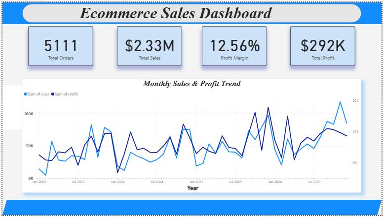
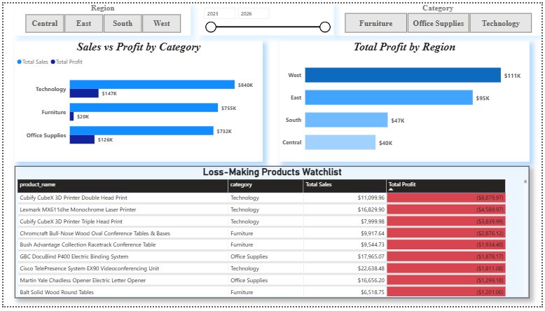
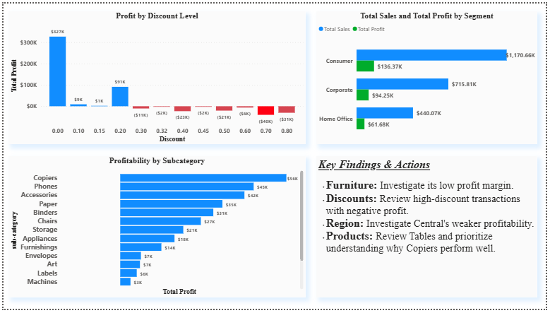

# E-Commerce Sales Analysis

An end-to-end data analytics project exploring e-commerce sales, profitability, product performance, regional results, customer segments, and discount patterns using Python, SQL, and Power BI.

> **Project status:** Analysis and three-page Power BI dashboard completed; repository documentation and final reproducibility checks in progress.

## 1. Project Objective

The objective of this project is to analyze e-commerce transaction data and turn it into useful business insights. The analysis focuses on understanding what drives sales and profit, identifying underperforming products and regions, and highlighting areas where management may need to investigate pricing and discount practices.

The project is designed to demonstrate a complete analytics workflow—from understanding business questions and preparing data to exploratory analysis, SQL querying, dashboard development, and evidence-based recommendations.

### Business questions

The analysis investigates questions such as:

- Which product categories and sub-categories generate the most sales and profit?
- Which products have high sales but weak or negative profitability?
- How do sales and profitability differ by region and customer segment?
- How does recorded discount level relate to profit?
- Which products and categories contain loss-making records?
- How do sales and profit change over time?
- How do shipping modes compare in shipping duration and business performance?

The dataset does not contain an explicit product-return indicator or customer age field. Therefore, product return rates and age-group purchasing patterns cannot be measured reliably from the available data.

## 2. Dataset Overview

The working dataset contains order, customer, geography, product, shipping, sales, quantity, discount, and profit fields.

| Dataset characteristic | Reported result |
|---|---:|
| Rows | 10,194 |
| Columns | 21 |
| Unique orders | 5,111 |
| Unique customers | 804 |
| Unique products | 1,862 |
| Product categories | 3 |
| Product sub-categories | 17 |
| Regions | 4 |
| Customer segments | 3 |

The figures above are the counts recorded during the project analysis. Confirm them against the final cleaned CSV when reproducing the project.

## 3. Tools and Technologies

- **Python** — analysis workflow and data preparation
- **Pandas** — data loading, cleaning, transformation, aggregation, and analysis
- **Matplotlib / Seaborn** — exploratory visualizations
- **Jupyter Notebook / JupyterLab** — documented analysis notebooks
- **SQL (SQLite)** — business queries, aggregations, subqueries, and CTEs
- **Microsoft Power BI Desktop** — interactive dashboard and DAX measures
- **Git and GitHub** — version control and project portfolio

## 4. Analysis Workflow

The project followed this workflow:

1. **Business understanding:** defined the business objective, stakeholders, questions, and hypotheses.
2. **Data understanding:** reviewed the dataset structure, columns, data types, and data quality.
3. **Data preparation:** checked data types and prepared date and numerical fields for analysis.
4. **Exploratory Data Analysis (EDA):** examined overall performance, category and sub-category results, regional performance, customer segments, discount levels, correlations, and time trends.
5. **SQL analysis:** queried product profitability, shipping modes, customers, state-level performance, order-value groups, and loss-making orders.
6. **Insights and recommendations:** translated observed patterns into investigation priorities and possible business actions.
7. **Power BI dashboard:** created three report pages—Executive Overview, Performance Analysis, and Profitability & Business Insights.
8. **Validation:** compared KPI cards with the reported analysis, checked the date range, reviewed visuals, and tested report interactions.
9. **Documentation:** organized notebooks, SQL, dashboard files, and screenshots for portfolio presentation.

## 5. Key Findings

The findings below are based on the results recorded during the project. They should be rechecked against the final cleaned dataset before being used for business decisions.

### Overall performance

- Reported total sales: **2,326,534.35**
- Reported total profit: **292,296.81**
- Reported overall profit margin: **12.56%**
- Reported unique orders: **5,111**

Profit margin is calculated as total profit divided by total sales.

### Category performance

| Category | Sales | Profit | Profit margin |
|---|---:|---:|---:|
| Technology | 839,893.28 | 146,543.38 | 17.45% |
| Furniture | 754,747.76 | 19,730.00 | 2.61% |
| Office Supplies | 731,893.31 | 126,023.44 | 17.22% |

Technology generated the highest reported sales and total profit. Furniture had a much lower profit margin than the other categories despite substantial sales, making it a priority for further investigation.

### Regional performance

| Region | Sales | Profit | Profit margin |
|---|---:|---:|---:|
| West | 739,813.61 | 110,798.82 | 14.98% |
| East | 691,828.17 | 94,883.26 | 13.71% |
| Central | 503,170.67 | 39,865.31 | 7.92% |
| South | 391,721.91 | 46,749.43 | 11.93% |

West led the reported regions in sales and profit. Central generated more sales than South but lower total profit and a lower profit margin, suggesting that its product mix, discounts, or other profitability factors should be investigated.

### Customer segment performance

| Segment | Sales | Profit | Profit margin |
|---|---:|---:|---:|
| Consumer | 1,170,659.79 | 136,371.45 | 11.65% |
| Corporate | 715,806.13 | 94,249.64 | 13.17% |
| Home Office | 440,068.43 | 61,675.73 | 14.02% |

Consumer generated the highest sales and total profit. Home Office had the highest reported profit margin, despite having the lowest sales of the three segments.

### Sub-category performance

- **Chairs** recorded the highest reported sub-category sales at **335,768.25**.
- **Copiers** generated the highest reported sub-category profit at **56,093.94**.
- **Tables** recorded a reported loss of **17,753.21**.
- **Bookcases** and **Supplies** also recorded negative total profit.
- **Machines** generated substantial sales but relatively low profit compared with those sales.

These results show why sales alone are not sufficient to evaluate product performance.

### Discount and loss-making records

The recorded analysis showed that several higher discount levels were associated with negative total profit. For example, the 70% discount group recorded a combined loss of **40,300.57**, and the 80% discount group recorded a combined loss of **30,565.27**.

This is an association, not proof that discounts alone caused the losses. Product mix, transaction characteristics, and costs may also contribute.

The loss-record analysis reported:

| Category | Loss-making records | Combined loss |
|---|---:|---:|
| Furniture | 732 | -61,675.18 |
| Office Supplies | 898 | -56,783.83 |
| Technology | 271 | -38,579.92 |

These counts refer to dataset records, not necessarily unique orders or customers.

### Data limitations

- The dataset has no explicit return indicator, so return rates could not be calculated.
- Customer age is not available, so age-based purchasing analysis was not possible.
- Repeated order IDs occur because one order can contain multiple product records.
- Outliers were treated as values to investigate, not automatically as errors.
- The date range was checked during dashboard validation; confirm the final source data and date range when reproducing the project.
- Correlation and grouped comparisons show relationships, not causation.

## 6. Business Recommendations

The recommendations below are proposed actions based on the observed results. They are not claims that the causes of the patterns have already been established.

1. **Investigate Furniture profitability.** Review loss-making products, discount levels, product mix, and available cost/pricing information before changing prices or product assortment.
2. **Review high-discount transactions.** Identify the products and transaction characteristics behind negative profit at higher discount levels. Consider stronger discount controls only after validating the causes.
3. **Investigate Central region performance.** Compare its product mix and discount patterns with stronger regions to identify possible explanations for its lower profit margin.
4. **Evaluate products using both sales and profit.** Investigate Tables, Bookcases, and Supplies, and examine what contributes to Copiers' strong profitability.
5. **Explore Home Office growth opportunities.** Test ways to grow sales while monitoring whether its relatively high profit margin can be maintained.
6. **Monitor loss-making records.** Track the number and financial impact of negative-profit records over time, distinguishing records from unique orders.

## 7. Power BI Dashboard

The Power BI report contains three pages:

1. **Executive Overview** — KPI cards for Total Sales, Total Profit, Profit Margin, and Total Orders, plus the sales and profit trend.
2. **Performance Analysis** — sales versus profit by category, total profit by region, and a loss-making products watchlist.
3. **Profitability & Business Insights** — profit by discount level, sales and profit by customer segment, profitability by sub-category, and a key findings/action panel.

### Dashboard screenshots

#### Executive Overview



#### Performance Analysis



#### Profitability & Business Insights




## 8. How to Reproduce the Analysis

### Prerequisites

- Python 3.10 or a compatible Python version
- Jupyter Notebook or JupyterLab
- Microsoft Power BI Desktop for the dashboard
- The authorized source CSV or the project's cleaned CSV

### Step 1: Clone or download the repository

```bash
git clone https://github.com/istiyaquekamil07-hub/Data-Analytics
cd P1-E-Commerce-Sales-Analysis
```


### Step 2: Install Python dependencies

```bash
pip install pandas numpy matplotlib seaborn jupyter
```

SQLite is accessed through Python's built-in `sqlite3` module, so a separate SQLite package is generally not required.

### Step 3: Add the dataset

Place the authorized CSV in the local `data/` folder. Update the file path in the notebooks to match its actual location. Do not assume the original local Windows path will work on another computer.

### Step 4: Run the notebooks

Open JupyterLab or Jupyter Notebook and run the notebooks in workflow order:

1. `01_Business_Question_Analysis.ipynb`
2. `02_Data_Cleaning.ipynb`
3. `03_EDA.ipynb`
4. `04_EDA_Findings.ipynb`
5. `05_SQL_Analysis.ipynb`
6. `06_Insights_and_Recommendations.ipynb`

Some notebooks may depend on variables or files created by earlier notebooks. Run them in order and update any local file paths before execution.

### Step 5: Open the Power BI report

Open `powerbi/P1_Ecommerce_Sales_Dashboard.pbix` in Power BI Desktop. If prompted, point the data source to the local cleaned CSV. Refresh the data, then compare KPI totals and visuals with the analysis outputs.

### Step 6: Validate the results

- Confirm row counts and unique-order counts.
- Compare total sales, total profit, and profit margin.
- Check date parsing and the date range.
- Verify category, region, segment, discount, and sub-category results.
- Test report filters and slicers.
- Investigate discrepancies rather than forcing results to match.

## 9. Project Outcome

This project demonstrates an end-to-end analytics workflow combining Python-based data preparation and exploration, SQL business querying, evidence-based interpretation, and an interactive Power BI report.

The main business priorities identified in the recorded analysis are investigating Furniture profitability, reviewing high-discount loss-making transactions, examining Central region profitability, and evaluating product performance using both sales and profit.

---

## Author

**Istiyaque Kamil**

- GitHub: https://github.com/istiyaquekamil07-hub
- LinkedIn: https://www.linkedin.com/in/istiyaque-kamil/
